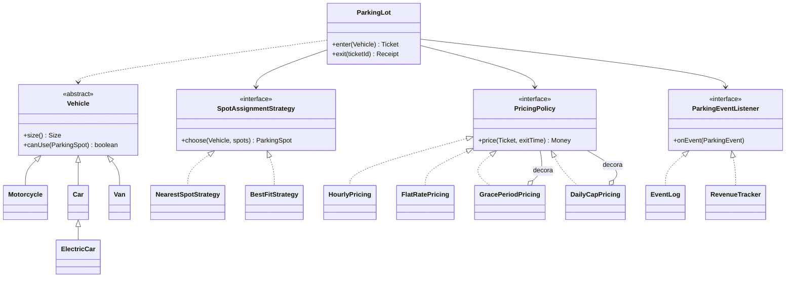

# Sistema de gestión de parking

Sistema de gestión de un aparcamiento escrito en **Java 21 puro, sin frameworks**, centrado en el diseño orientado a objetos. Modela distintos tipos de vehículo (motos, coches, coches eléctricos y furgonetas), plazas de varios tamaños repartidas en plantas y con puntos de carga, tickets de entrada y recibos de salida. Las tarifas son configurables y combinables: por hora empezada según el tamaño del vehículo, primeros minutos gratis y precio máximo por día. Las barreras de entrada pueden funcionar en paralelo sin que dos vehículos reciban nunca la misma plaza. Incluye una demo que simula un día completo y tests que cubren las reglas de negocio y la concurrencia.

## Arquitectura

El diseño aplica los principios **SOLID** y los patrones clásicos de la POO. Los vehículos forman una **jerarquía polimórfica**: cada tipo decide su tamaño y en qué plazas puede aparcar, y el coche eléctrico amplía esa regla para poder usar los cargadores. El `ParkingLot` coordina entradas y salidas, pero delega las decisiones en piezas intercambiables que recibe por constructor. Una **estrategia** decide qué plaza asignar (la más cercana o la que mejor encaja) y otra calcula el precio. Las tarifas se pueden ampliar con **decoradores**, que se apilan sin modificar el código existente. Los eventos (entrada, salida, entrada rechazada) son un tipo **sealed** que se notifica a observadores, como el registro de actividad o el contador de recaudación. El estado compartido se protege con un `ReentrantLock`, y el tiempo se inyecta con un `Clock` para poder simular horas en los tests.



## Requisitos y cómo arrancarlo

Requisito único: **Java 21**. No necesita base de datos ni Docker, y tampoco hace falta instalar Maven, porque el proyecto incluye el wrapper `mvnw`.

```bash
./mvnw package                            # compila y ejecuta los tests
java -jar target/parking-lot-1.0.0.jar    # demo: simula un día en un parking de dos plantas
```

La demo imprime el registro de entradas, salidas y rechazos, y la recaudación por tipo de vehículo. Para ejecutar solo los tests: `./mvnw test`.
